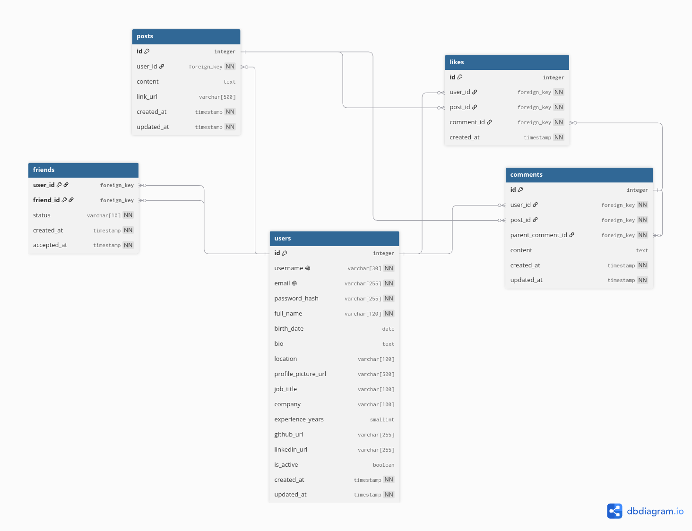

# social-network-db

Banco de dados de uma **rede social para desenvolvedores**, com usuários, postagens, amizades, comentários e curtidas.

Atividade **ME – Medida de Eficiência (Primeira Entrega)**.

## Diagrama ER

Modelado no [dbdiagram.io](https://dbdiagram.io/).



## Estrutura

```
social-network-db/
├── README.md
├── docs/
│   └── social_network.png   # diagrama ER
└── sql/
    └── social_network.sql   # script de criação do banco
```

## Como executar

```bash
createdb social_network
psql -d social_network -f sql/social_network.sql
```

Ou, no DBeaver, abra `sql/social_network.sql` conectado ao banco e execute como script (**Alt + X**).

## Tabelas

| Tabela | Descrição |
|---|---|
| `users` | Dados pessoais e profissionais dos usuários |
| `posts` | Postagens com texto e/ou link |
| `friends` | Conexões de amizade entre usuários (pedido e aceite) |
| `comments` | Comentários nas postagens, com respostas a outros comentários |
| `likes` | Curtidas em postagens e comentários |

## Relacionamentos

| Relação | Chave estrangeira | Tipo |
|---|---|---|
| Um usuário faz várias postagens | `posts.user_id` → `users.id` | 1:N |
| Um usuário envia vários pedidos de amizade | `friends.user_id` → `users.id` | 1:N |
| Um usuário recebe vários pedidos de amizade | `friends.friend_id` → `users.id` | 1:N |
| Um usuário escreve vários comentários | `comments.user_id` → `users.id` | 1:N |
| Uma postagem recebe vários comentários | `comments.post_id` → `posts.id` | 1:N |
| Um comentário recebe várias respostas | `comments.parent_comment_id` → `comments.id` | 1:N |
| Um usuário dá várias curtidas | `likes.user_id` → `users.id` | 1:N |
| Uma postagem recebe várias curtidas | `likes.post_id` → `posts.id` | 1:N |
| Um comentário recebe várias curtidas | `likes.comment_id` → `comments.id` | 1:N |

A tabela `friends` liga `users` a ela mesma, formando uma relação **N:N** de amizade. Da mesma forma, `comments` e `likes` formam relações **N:N** entre usuários e postagens.

---

Desenvolvido por **Gabriel Gomes**.
